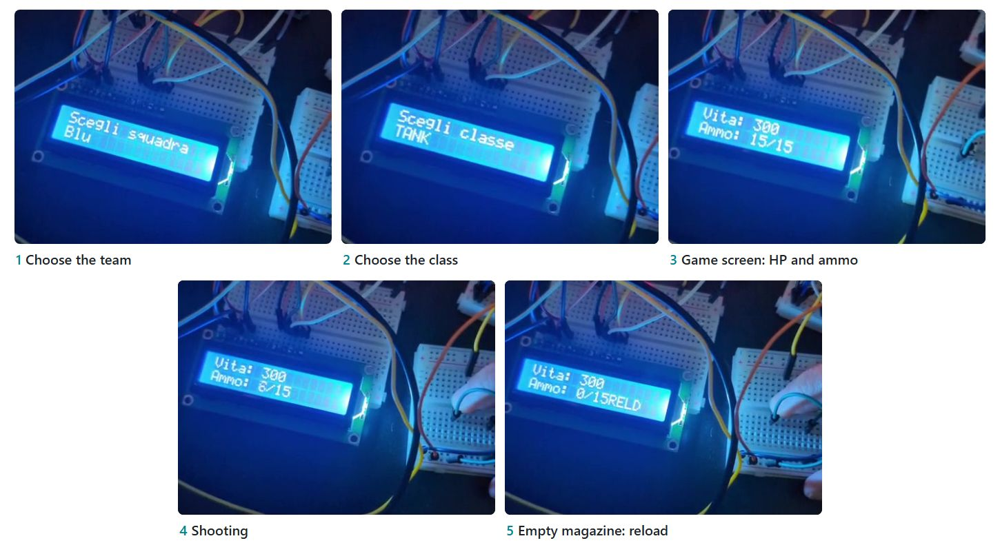
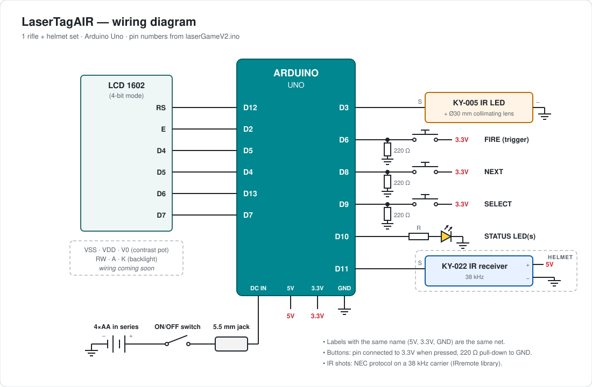
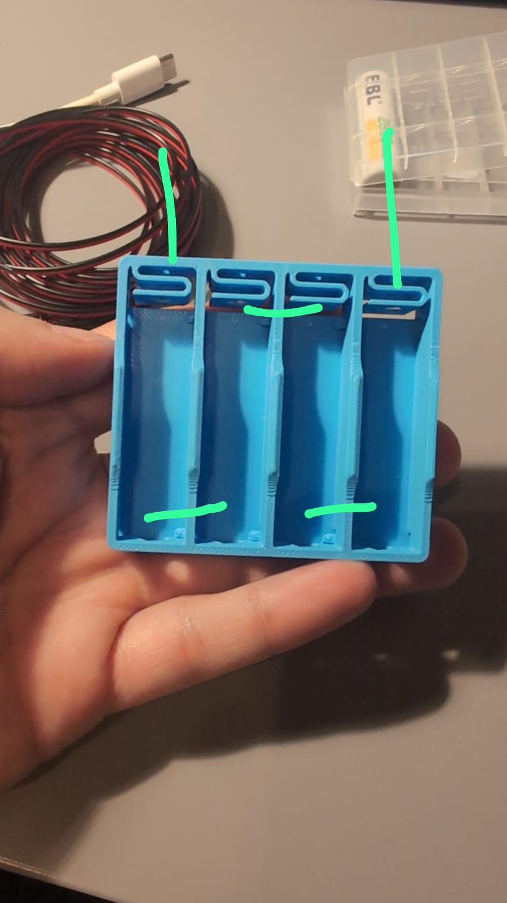
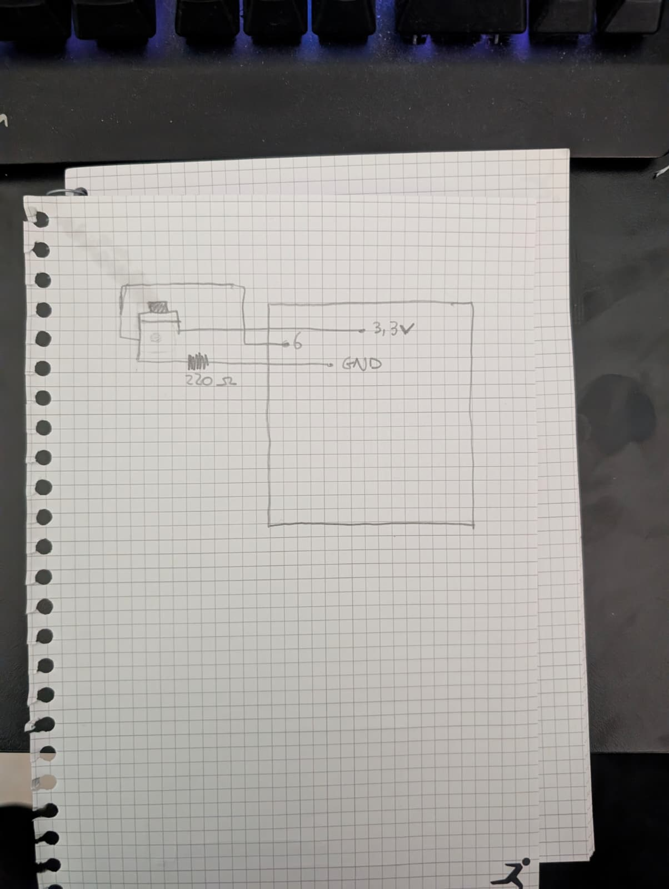
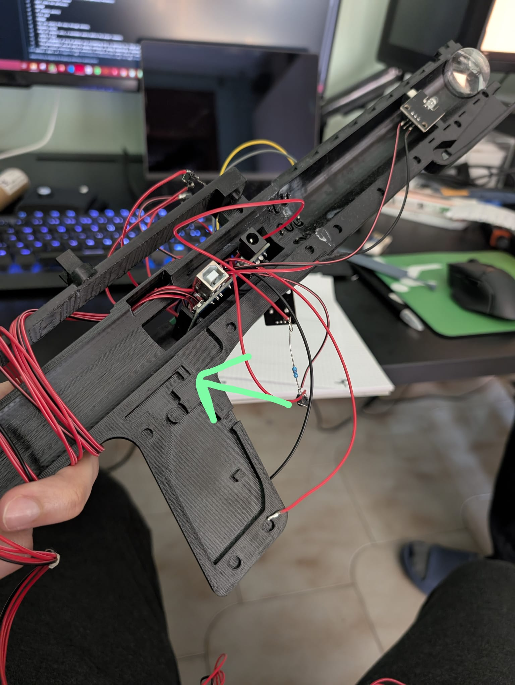
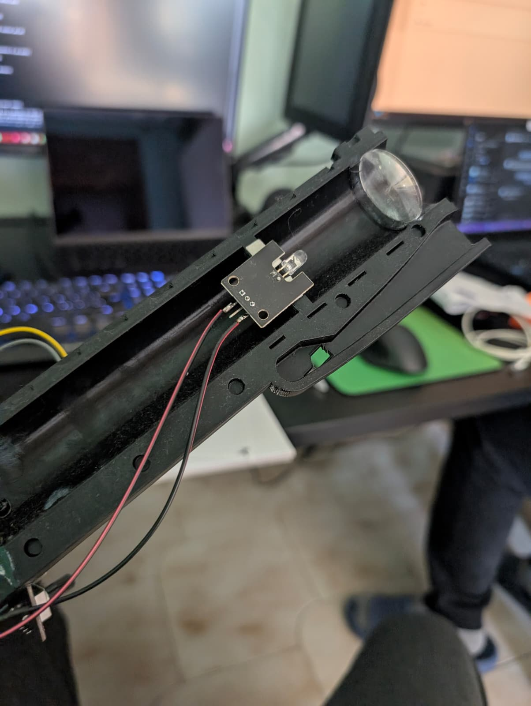
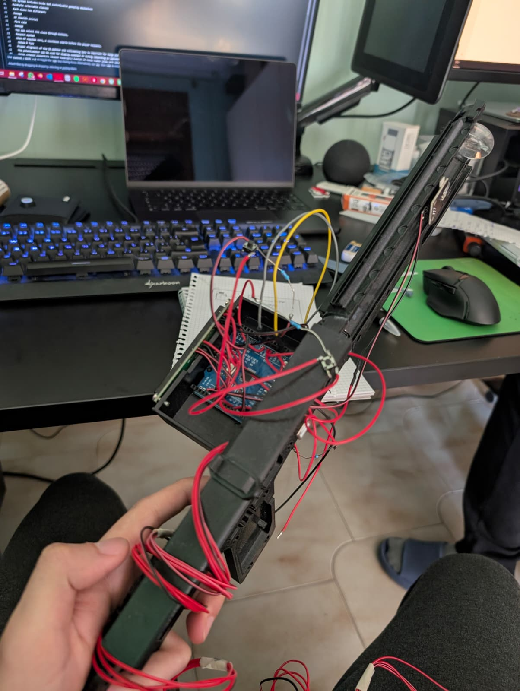
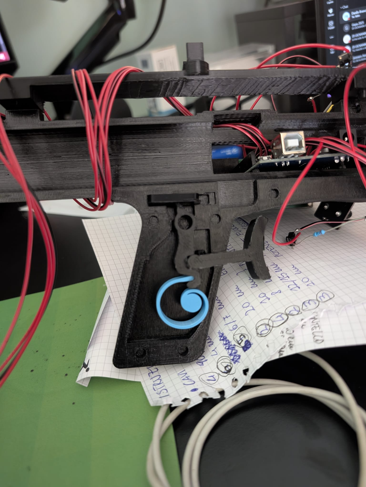

# DIY Low-Budget Arduino Laser Tag System

This project is an Arduino-based laser tag system designed for customizable, low-cost gameplay. It combines infrared (IR) communication, sensors and visual feedback to simulate a real laser tag experience.

Each player uses a **rifle** (IR transmitter, LCD, buttons) and a **helmet** (IR receiver). The system supports multiple players split into two teams.

## Demo

Breadboard prototype: team and class selection, game screen, shooting and reload.

▶ [Full video (37 s, no audio)](Process_Images/menuDemo.mp4)

---

## Features

- **Two teams**: Red and Blue, selected from the on-screen menu.
- **Three classes** with different HP, damage, magazine size, fire rate and reload time (see [Classes](#classes)).
- **Encoded IR shots**: every shot carries the shooter's team and class (NEC protocol), so the helmet knows who hit you and how much damage to apply.
- **Full-auto fire** while the trigger is held, limited by the fire rate of the class.
- **Reload**: when the magazine is empty, pull the trigger to reload. The status LED blinks while reloading.
- **Hit feedback**: the status LED flashes when you get hit.
- **Respawn**: when your HP reaches zero, a 30-second countdown starts. Then you respawn with full HP and ammo.
- **LCD HUD** (16×2) showing HP and ammo.

## Classes

| Class | HP | Damage per hit | Magazine | Fire rate | Reload time |
|---|---:|---:|---:|---:|---:|
| ASSALTO (Assault) | 100 | 20 | 30 | 4 shots/s | 4 s |
| TANK | 300 | 12 | 15 | 5 shots/s | 2.5 s |
| ASSASSINO (Assassin) | 60 | 240 | 1 | 1 shot/s | 10 s |

Hits needed to eliminate a player:

| Shooter ↓ / Target → | Assault | Tank | Assassin |
|---|:---:|:---:|:---:|
| **Assault** | 5 | 15 | 3 |
| **Tank** | 9 | 25 | 5 |
| **Assassin** | 1 | 2 | 1 |

All values can be changed in the `classData` array in [`laserGameV2.ino`](laserGameV2/laserGameV2.ino).

## How to play

1. Switch on the rifle. The LCD shows **"Scegli squadra"** (choose team): press **Next** to switch between *Rossa* (Red) and *Blu* (Blue), then **Select** to confirm.
2. The LCD shows **"Scegli classe"** (choose class): press **Next** to cycle through the classes, then **Select** to confirm.
3. The game starts and the LCD shows **Vita** (HP) and **Ammo**. Hold the trigger to shoot.
4. When the magazine is empty, pull the trigger again to reload (**RELD** on the display).
5. When your HP reaches zero, the LCD shows **"SEI MORTO!"** (you are dead) and a 30-second countdown. Then you respawn with the same team and class.

> The on-screen texts are in Italian.

---

## Components (for 1 rifle + helmet set)

- Arduino Uno R3 / R4 or compatible clone with solderable headers (mandatory if you don't want to use breadboards or solderable PCBs)
- KY-005 IR emitter LED (5 mm)
- KY-022 IR receiver module
- Collimating lens (Ø 30 mm, focal length 50 mm)
- LCD 1602 display
- Battery pack (4× AA batteries)
- On/off switch
- Potentiometer (LCD contrast)
- 5.5 mm barrel jack adapter (to power the Arduino from the battery pack)
- One or more standard LEDs (can be placed in parallel)
- 3 push buttons
- Resistors (various values, ~220 Ω to 10 kΩ)
- Jumper wires (a Dupont crimping kit is highly recommended)
- Soldering equipment (tin, iron, etc.)
- 3D printed parts
- Any kind of glue
- Helmet: any 3D printed or recycled helmet with the IR receiver and the LED installed

## Software

- [Arduino IDE](https://www.arduino.cc/en/software)
- [IRremote](https://github.com/Arduino-IRremote/Arduino-IRremote) by Armin Joachimsmeyer, version 4.x (install it from the Library Manager)
- LiquidCrystal (included with the Arduino IDE)

Open [`laserGameV2/laserGameV2.ino`](laserGameV2/laserGameV2.ino), select your board and upload.

## 3D printed parts

The STL files will soon be available on my MakerWorld page:

- Rifle body
- Trigger mechanism
- Battery pack housing (you can also buy one on AliExpress)

  

  
  
  

Print everything and prepare the parts before assembly.

---

## Wiring

| Arduino pin | Connected to | Notes |
|---|---|---|
| D3 | KY-005 IR LED, signal (S) | IR shots. Module GND → GND |
| D11 | KY-022 IR receiver, signal (S) | On the helmet. VCC → 5V, GND → GND |
| D6 | Fire button (trigger) | Other side of the button → 3.3V, 220 Ω pull-down → GND |
| D8 | Next button | Same wiring as the fire button |
| D9 | Select button | Same wiring as the fire button |
| D10 | Status LED(s) | Through a series resistor, LED cathode → GND |
| D12, D2, D5, D4, D13, D7 | LCD RS, E, D4, D5, D6, D7 | 4-bit mode |
| DC jack | 4× AA battery pack | Through the on/off switch and the 5.5 mm barrel jack |

**LCD:** power, contrast (potentiometer) and backlight wiring coming soon.

### Power

The 3D printed battery holder takes 4 AA cells in series. The green marks in the photo show the connections between the contacts:

- top side: between the 2nd and the 3rd cell;
- bottom side: between the 1st and the 2nd cell, and between the 3rd and the 4th cell.

The two output wires (1st and 4th cell) go, through the on/off switch, to a 5.5 mm barrel jack that plugs into the Arduino power socket.

### Buttons

The three buttons share the same wiring, shown here for the fire button:

  
  

---

## Assembly

1. Mount all electronic components inside the printed parts.
2. Wire everything according to the [wiring diagram](#wiring).
3. Solder the connections where needed for stability.

  
  

### Trigger mechanism

---

## Notes & tips

- Proper alignment of the IR emitter and the collimating lens is important for range and accuracy.
- Crimped connectors (Dupont terminals) instead of loose jumper wires make everything much more reliable.
- The system is easy to expand: sound effects, score tracking, new classes or game modes.
